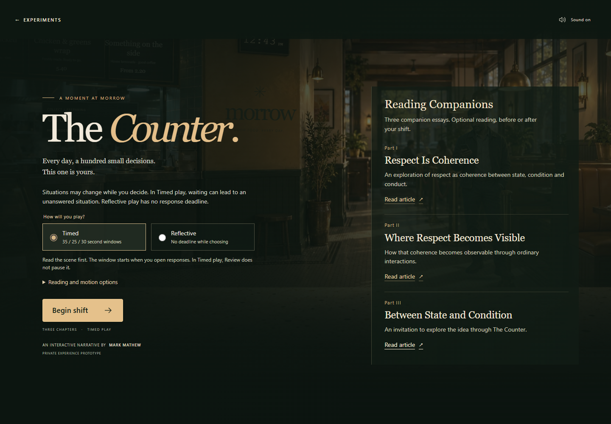

# The Counter

**An interactive narrative by Mark Mathew.** Three first-person encounters at Morrow, a fictional restaurant, about decisions, expectations and what remains unresolved.

**[Play The Counter](https://markmathew.com/experiments/the-counter/)**



## Run locally

Requires Node.js 24+ and npm. No API key or external service is needed to play.

```powershell
git clone https://github.com/markusimperative/the-counter.git
cd the-counter
npm ci
npm run dev
```

Open `http://127.0.0.1:5173/`. Choose Timed or Reflective play; Continue advances captions. Tab/arrows and number keys focus responses; Enter/Space activates them. Mute, reading support and reduced-motion options are available.

```powershell
npm test
npm run lint
npm run build
npm run preview
```

Tests run once. Preview normally uses `http://127.0.0.1:4173/`. Artwork and recordings are bundled locally. Article and GitHub links require internet only when followed. Optional voice regeneration downloads its authoring model; that model is not part of gameplay or this repository.

## Experience and boundaries

Three chapters support 64 deterministic Timed histories, including unanswered moments, and 27 Reflective histories. An optional six-question reflection follows the narrative. There are no scores, preferred answers, analytics, accounts or public response collector.

Normal/framed visitors may open Reading Companions before playing. `?mode=pilot` and the earlier `?entry=unprimed-pilot` omit them until a completed survey, explicit skip or decline. **Behind The Counter** appears only on that committed final screen in both flows, after the narrative and survey. Survey participation is not required. Replay clears drafts and resets these reveal gates.

Part III is published at [Between State and Condition](https://notes.markmathew.com/p/between-state-and-condition). Parts I and II retain their existing public links. Captions remain functional without sound.

The development/preview server includes a loopback-only pilot receiver. Explicitly consented saves go to ignored `pilot-responses/`; static production has no collector and offers an optional local file export. Never commit participant files. Generated test exports are not included in this public snapshot.

## Structure

- `src/narrative/`: typed authored scenes, pure reducer and timing tests.
- `src/components/`: scene, dialogue, survey, article previews and final source discovery.
- `src/reflection/`: optional survey state, consent and local/export transport.
- `src/audio/`, `src/performance/`: browser sound and character presentation.
- `src/reading/companions.ts`: the shared article manifest.
- `public/`: original runtime artwork and recordings.
- `assets/`: original PNGs, prompts, provenance and third-party license notice.
- `server/`: local-only pilot receiver and tests.
- `scripts/`: optional artwork and speech authoring utilities.

[Architecture and visibility](docs/architecture.md) · [Asset provenance](ASSETS.md)

## Website integration

The independent [personal website](https://github.com/markusimperative/markmathew-site) consumes `npm run build:site`, which uses the base `/experiments/the-counter/`. Clone both projects as siblings when building that website. The standard game build remains rooted at `/`.

## Publication and rights

This is a clean source snapshot. Original development history, local deployment evidence, archived builds, response files, caches and credentials were intentionally excluded. Original art, recorded audio, prompts and tests are included; no inference model, voice embedding or operating-system font is redistributed.

**No project-wide open-source license has been assigned.** Public source inspection does not grant a separate general reuse license. The bundled Kokoro Apache-2.0 notice applies to the identified third-party authoring software/model provenance, not to the entire project. See [ASSETS.md](ASSETS.md).
